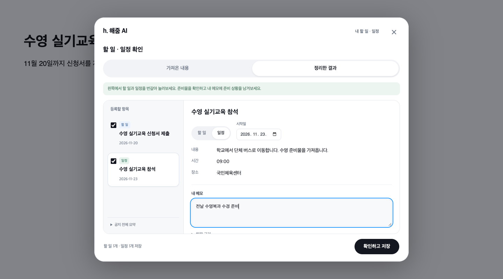
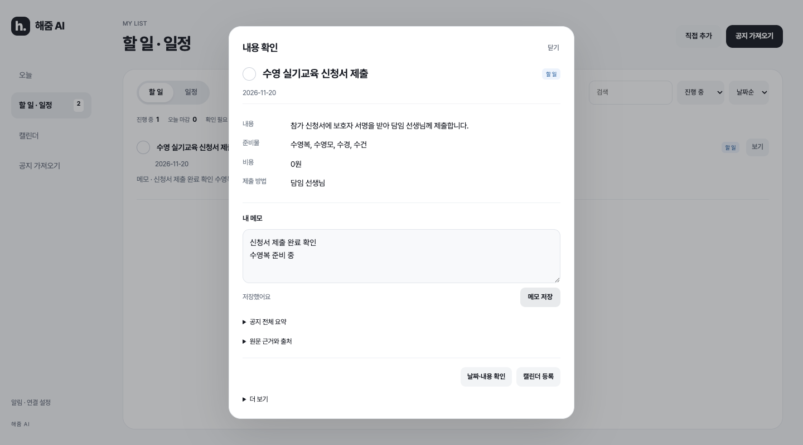

# 해줌 AI

**공지를 내 할 일로.** 학교 공지에서 해야 할 일과 마감일을 찾아 정리하고, 마감 전에 알려 주는 Chrome 확장 프로그램입니다.

[소개 사이트](https://haezoom-ai.vercel.app) · [개발 과정](https://haezoom-ai.vercel.app/process/) · [설치 파일 내려받기 (3.1.0)](dist/haezoom-ai-extension-3.1.0.zip)



## 이렇게 씁니다

1. 공지를 읽던 페이지에서 필요한 문장을 드래그하고 **해줌으로 정리**를 누릅니다. 표나 이미지로 된 공지는 화면 캡처로, PDF는 페이지를 골라 가져옵니다.
2. 보낼 내용을 확인하고 동의하면 분석을 시작합니다. 동의하기 전에는 아무것도 보내지 않습니다.
3. 할 일과 일정으로 나뉜 결과에서 날짜·준비물·비용·제출 방법을 확인하고, 필요한 항목만 골라 저장합니다.
4. 저장한 항목은 워크스페이스에서 목록과 달력으로 관리하고, 마감 3일 전·하루 전·당일에 Chrome 알림을 받습니다.

## 주요 기능

| 구분 | 기능 |
|---|---|
| 가져오기 | 문장 선택, 화면 캡처, PDF(20MB·30쪽까지, 고른 한 페이지씩 분석). 페이지의 h. 버튼, 툴바 아이콘, 우클릭 메뉴, 단축키(`Alt+Shift+H` 선택 문장 정리, `Alt+Shift+C` 화면 캡처)로 시작 |
| 정리 | 할 일·일정 분류, 날짜·준비물·비용·제출 방법 정리. 연도가 빠진 날짜는 추측하지 않고 ‘확인 필요’로 표시하고, ‘다음 주 금요일’ 같은 표현에는 후보 날짜를 보여 줍니다. 후보는 눌러야 입력됩니다 |
| 관리 | 오늘 할 일, 월간 달력, 검색·필터, 완료와 되돌리기, 항목별 메모, JSON 백업과 복원 |
| 알림·캘린더 | Chrome 알림(마감 3일 전·하루 전·당일, 일정 시작 30분 전), 캘린더 파일(`.ics`) 내보내기, Google Calendar 등록 |



## 설치

1. [dist/haezoom-ai-extension-3.1.0.zip](dist/haezoom-ai-extension-3.1.0.zip)을 내려받아 압축을 풉니다. 나온 `haezoom-ai-extension` 폴더는 지우거나 옮기지 않을 곳에 둡니다.
2. Chrome 주소창에 `chrome://extensions`를 열고 오른쪽 위 **개발자 모드**를 켭니다.
3. **압축해제된 확장 프로그램을 로드합니다**를 눌러 `haezoom-ai-extension` 폴더를 고릅니다.
4. 카드에 표시된 ID가 `nlfhehdelekmadneoopeciaemejkmale`인지 확인하고, 툴바에 해줌을 고정합니다.

저장소에서 바로 설치할 때는 3번에서 `extension` 폴더를 고릅니다. 모든 사이트에서 h. 버튼을 쓰려면 **연결·설정 → 해줌 버튼 표시**를 허용하고, 내 컴퓨터의 PDF에서 쓰려면 확장 세부정보에서 **파일 URL에 대한 액세스 허용**을 켭니다.

> **3.0.x에서 올리는 경우:** 3.1.0부터 확장 ID를 고정해서 Chrome이 새 확장으로 인식합니다. 먼저 **알림 · 연결 설정 → 데이터 백업 → 내려받기**로 저장한 항목을 받아 두고, 새로 설치한 뒤 같은 곳의 **가져오기**로 복원해 주세요.

Chrome 설정, 웹 스토어처럼 확장이 들어갈 수 없는 페이지에서는 페이지 안 메뉴 대신 워크스페이스가 열립니다.

## 데이터 처리

- 분석에 동의한 문장과 이미지만 해줌 서버(Cloudflare Worker, `haezoom.sleepwhale.workers.dev`)를 거쳐 Claude API로 보냅니다. API 키는 서버에만 있고 확장에는 넣지 않습니다.
- 저장한 할 일·일정·메모는 지금 쓰는 Chrome 프로필 안에만 저장합니다.
- Google Calendar 등록은 사용자가 직접 연결하고 등록을 누를 때만 진행합니다.
- 서버는 같은 IP에서 1분에 10번까지 분석 요청을 받습니다.

## Google Calendar 연결

Google Cloud 프로젝트 `haezoom-ai`에 Calendar API와 OAuth 동의 화면(범위 `calendar.events`)을 설정했습니다. 지금은 테스트 모드라 **테스트 사용자로 등록한 계정만** 연결할 수 있고, 등록한 계정으로 로그인하는 것까지 확인했습니다. Google 앱 검토를 거쳐 정식으로 게시하면 등록 없이 바로 연결할 수 있습니다.

| 항목 | 값 |
|---|---|
| Chrome 확장 클라이언트 | `extension/manifest.json`의 `oauth2.client_id` |
| 웹 애플리케이션 클라이언트 | 리디렉션 `https://nlfhehdelekmadneoopeciaemejkmale.chromiumapp.org/`, `extension/google-config.mjs` |

Chrome에 로그인한 계정은 바로 연결하고, Chrome에 로그인하지 않았거나 Edge·Whale을 쓰면 Google 로그인 창으로 연결합니다. 테스트 사용자는 Google Cloud 콘솔 → Google 인증 플랫폼 → 대상에서 추가합니다(최대 100명). 클라이언트 ID는 비밀값이 아니며, 웹 클라이언트의 보안 비밀은 쓰지 않으므로 저장소에 넣지 않습니다. 웹 스토어에 올리면 스토어가 주는 ID로 확장 클라이언트를 하나 더 만들어야 합니다.

Google 계정 없이도 달력 화면의 **캘린더 파일 받기**로 Apple·Google·Outlook·삼성 캘린더에 옮길 수 있습니다.

## 폴더 구성

| 경로 | 내용 |
|---|---|
| `extension/` | Chrome 확장 프로그램. 빌드 없이 그대로 로드합니다 |
| `cloudflare-worker.js`, `wrangler.toml` | 분석 서버(Cloudflare Worker) |
| `booth/` | 2026 서울학생 AI 개발 성과발표회 부스 시연 사이트. 진행 방법은 [booth/README.md](booth/README.md) |
| `demo/` | 소개·체험 사이트. 실행 방법은 [demo/README.md](demo/README.md) |
| `public/` | 처음 만든 웹 버전 |
| `tests/`, `scripts/` | 검사와 설치 파일 만들기 |
| `docs/` | [구조·데이터 계약](docs/HANDOFF.md), [검증 기록](docs/QA.md), [화면 설계](docs/DESIGN.md), [남은 일](docs/TEAM_HANDOFF.md) |
| `dist/` | 설치용 압축 파일 |

부스 사이트는 `python3 -m http.server 4180 --directory booth`, 체험 사이트는 `python3 -m http.server 4173 --directory demo`로 켭니다.

## 개발

Node 22 이상이 필요합니다.

```sh
npm ci
npx playwright install chromium
npm test              # 단위 검사
npm run check         # manifest·자산·버전 정적 검사
npm run format:check  # Prettier 형식 검사
node tests/browser.mjs
node tests/notes-browser.mjs
node tests/global.mjs
node tests/offscreen.mjs
node tests/pdf.mjs
node tests/enhance-browser.mjs
node tests/booth-browser.mjs
node tests/ux-browser.mjs
npm run package       # dist/에 설치 파일 만들기
```

push와 PR마다 GitHub Actions가 단위·정적·형식 검사와 확장 브라우저 검사를 실행합니다. `tests/demo-browser.mjs`와 `tests/service-browser.mjs`는 3.0 이후 바뀐 `demo/` 화면을 아직 반영하지 못해 실패하므로 CI에서 뺐습니다. `tests/release-browser.mjs`와 `scripts/verify-live-ai.mjs`는 실제 AI를 호출해 비용이 들 수 있습니다. 나머지 화면 검사는 모의 응답과 임시 브라우저 프로필을 씁니다.

## 남은 일

- 실제 계정으로 Google Calendar 등록·수정·삭제 확인, Google 앱 검토
- macOS·Windows에서 알림 표시와 클릭, Chrome 종료 후 복구 확인
- 표·스캔·작은 글씨 공지로 추출 정확도 측정
- 분석 서버의 비용 상한과 사용자별 접근 제한

## 팀

서울인공지능고등학교 AI컴퓨터과

| 역할 | 이름 |
|---|---|
| PM | 박서준 |
| AI 개발 | 김민재 |
| 프로덕트 디자인 | 김채령 |
| 프론트엔드 개발 | 박지훈 |
| UX 리서치 | 이수영 |

팀원 저장소 [wodlelflt/haezoom-ai](https://github.com/wodlelflt/haezoom-ai)의 작업을 이어받아 개발했습니다. PDF.js·Tesseract·Pretendard는 각 라이선스를 따르고, 새로 만든 아이콘의 라이선스는 `extension/icons/LICENSE`에 있습니다.
